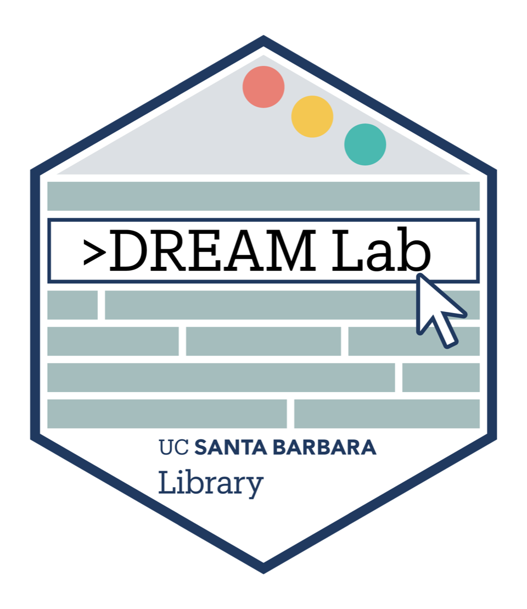

```{=html}
<main id="quarto-document-content" class="home-main">
  <section class="home-intro">
    <div class="site-grid home-intro__grid">
      <div class="home-intro__content">
        <p class="home-eyebrow">
          <span aria-hidden="true"></span>
          UCSB Library
        </p>
        <h1>
          DREAM Lab<br>
          Cloud Services
        </h1>
        <p class="home-intro__lede">
          Secure, accessible cloud environments that help UCSB researchers,
          instructors, and students move from an idea to functional and working
          code. Managed by the <a href="https://www.library.ucsb.edu/dreamlab">UCSB Library DREAM Lab</a>
          with computing resources provided by <a href="https://www.lsit.ucsb.edu">College of Letters and Science IT</a>.
        </p>
        <div class="home-actions">
          <a class="home-button home-button--gold" href="https://coder.dreamlab.ucsb.edu" target="_blank" rel="noopener">
            Launch a Workspace<span class="sr-only"> (opens in a new tab)</span>
          </a>
          <a class="home-button home-button--outline" href="guides/getting-started.html">
            Getting Started
          </a>
        </div>
      </div>
      <div class="home-intro__visual">
        <div class="dream-badge-frame">
          
        </div>
      </div>
    </div>
  </section>

  <section class="home-section" id="services">
    <div class="site-grid">
      <div class="home-section__heading">
        <div>
          <p class="home-eyebrow">
            <span aria-hidden="true"></span>
            Cloud services
          </p>
          <h2>What we offer</h2>
        </div>
        <p>
          Flexible tools supported by people who understand research,
          teaching, and creative practice.
        </p>
      </div>

      <div class="offer-grid">
        <article class="offer-card offer-card--workspace">
          <div class="offer-card__icon" aria-hidden="true">
            <svg viewBox="0 0 48 48" focusable="false">
              <rect x="5" y="8" width="38" height="31" rx="2"></rect>
              <path d="M5 16h38M12 12h1M17 12h1"></path>
              <path d="m16 25 5 4-5 4M25 33h8"></path>
            </svg>
          </div>
          <div class="offer-card__content">
            <h3>Coder Workspaces</h3>
            <p>
              Launch a ready-to-use development environment in your browser
              with pre-installed data science tools, RStudio, JupyterLab, VS Code,
              and computing resources for the academic quarter.
            </p>
            <a class="home-link" href="coder.html">
              Explore Coder Workspaces
              <span aria-hidden="true">→</span>
            </a>
          </div>
        </article>

        <article class="offer-card offer-card--gateway">
          <div class="offer-card__icon" aria-hidden="true">
            <svg viewBox="0 0 48 48" focusable="false">
              <path d="M24 12v9M13 31l8-5M35 31l-8-5"></path>
              <path d="m24 5 6 3.5v7L24 19l-6-3.5v-7L24 5ZM13 25l6 3.5v7L13 39l-6-3.5v-7l6-3.5ZM35 25l6 3.5v7L35 39l-6-3.5v-7l6-3.5Z"></path>
            </svg>
          </div>
          <div class="offer-card__content">
            <span class="experimental-label">Experimental</span>
            <h3>AI Gateway</h3>
            <p>
              Experiment with approved generative AI models through an
              OpenAI-compatible, research-friendly API for coding agents and
              custom workflows.
            </p>
            <a class="home-link" href="guides/ai-gateway.html">
              Learn about the AI Gateway
              <span aria-hidden="true">→</span>
            </a>
          </div>
        </article>
      </div>
    </div>
  </section>

  <section class="home-section home-section--tint" id="getting-started">
    <div class="site-grid">
      <div class="home-section__heading">
        <div>
          <p class="home-eyebrow">
            <span aria-hidden="true"></span>
            A simple start
          </p>
          <h2>Getting started in 3 steps</h2>
        </div>
        <a class="home-link" href="guides/getting-started.html">
          Read the full guide
          <span aria-hidden="true">→</span>
        </a>
      </div>

      <ol class="steps-list">
        <li>
          <span class="steps-list__number">01</span>
          <div>
            <span class="step-hex step-hex--coral" aria-hidden="true"></span>
            <h3>Log in with your UCSB NetID</h3>
            <p>
              Visit <a href="https://coder.dreamlab.ucsb.edu">coder.dreamlab.ucsb.edu</a>
              and sign in with UCSB Single Sign-On.
            </p>
          </div>
        </li>
        <li>
          <span class="steps-list__number">02</span>
          <div>
            <span class="step-hex step-hex--gold" aria-hidden="true"></span>
            <h3>Create a workspace</h3>
            <p>
              Choose your workspace name and optional services like RStudio,
              JupyterLab, or VS Code.
            </p>
          </div>
        </li>
        <li>
          <span class="steps-list__number">03</span>
          <div>
            <span class="step-hex step-hex--green" aria-hidden="true"></span>
            <h3>Open it in your browser</h3>
            <p>
              Start coding in the browser or connect remotely from your desktop
              VS Code or terminal via SSH.
            </p>
          </div>
        </li>
      </ol>
    </div>
  </section>

  <section class="home-help" id="support">
    <div class="site-grid home-help__inner">
      <div>
        <p class="home-eyebrow home-eyebrow--light">
          <span aria-hidden="true"></span>
          Support
        </p>
        <h2>Need help?</h2>
        <p>
          Find quick answers in our guides and FAQ, join the UCSB Carpentry
          Slack community, or reach out to the DREAM Lab team at
          <a href="mailto:dreamlab@library.ucsb.edu" class="home-help__inline-link">dreamlab@library.ucsb.edu</a>.
        </p>
      </div>
      <div class="home-help__links">
        <a href="faq.html">
          <span>Browse common questions</span>
          <strong>Visit the FAQ</strong>
        </a>
        <a href="https://join.slack.com/t/ucsbcarpentry/shared_invite/zt-3chxqtb2b-cVc3l~yj1ghUhZLNmOLfhQ" target="_blank" rel="noopener">
          <span>Community support</span>
          <strong>Join UCSB Carpentry Slack<span class="sr-only"> (opens in a new tab)</span></strong>
        </a>
        <a href="guides/index.html">
          <span>Step-by-step walkthroughs</span>
          <strong>Browse All Guides</strong>
        </a>
        <a href="https://www.library.ucsb.edu/dreamlab" target="_blank" rel="noopener">
          <span>Meet with our team</span>
          <strong>About the DREAM Lab<span class="sr-only"> (opens in a new tab)</span></strong>
        </a>
      </div>
    </div>
  </section>
</main>
```
